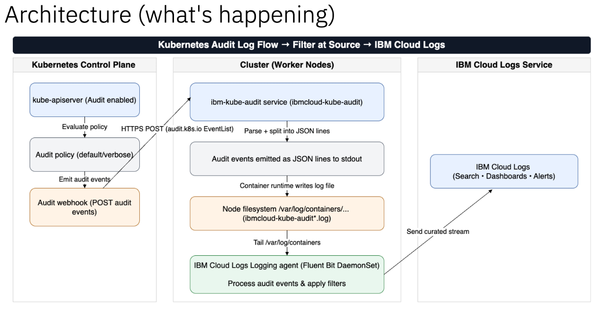

---

copyright:
  years:  2024, 2026
lastupdated: "2026-11-23"

keywords:

subcollection: cloud-logs

---

{{site.data.keyword.attribute-definition-list}}


# How do I manage kubernetes audit logs in {{site.data.keyword.logs_full_notm}}
{: #kubernetes-audit-logs}

The Kubernetes API audit logs provide a security-relevant, chronological record of API activity and are designed to answer questions like what happened, who initiated it, and what resource was involved. However, audit logs can be very high volume, which makes downstream search and alerting harder and increases ingestion/storage costs. 
You can filter audit events at the source using the IBM Cloud Logs agent (Fluent Bit–based) and YAML filters under `additionalFilters` in the Helm `values.yaml`, then ship the curated stream to {{site.data.keyword.logs_full}}.
{: shortdesc}

You can:

1. Identify the audit records coming from `ibm-kube-audit` pipeline and distinguish them by tag.

2. Configure Fluent Bit grep `filters under additionalFilters` to keep or exclude events, including nested-field matching via record accessors.

3. Validate that filtered audit logs are arriving in {{site.data.keyword.logs_full}} and confirm volume reduction without losing key security events.


## Before you begin
{: #kubernetes-audit-logs-prereq}

* IBM Cloud Kubernetes Service (IKS) or Red Hat OpenShift on IBM Cloud cluster with Kubernetes API audit forwarding configured. For more information, see [Forwarding Kubernetes API audit logs](/docs/containers?topic=containers-health-audit). The configuration should be setup using the verbose policy when setting up the webhook.

* {{site.data.keyword.logs_full}} instance ready to receive log data.

* {{site.data.keyword.agent}} deployed via Helm (agent is Fluent Bit–based).

   {: caption="Architecture" caption-side="bottom"}

* Kubernetes audit events originate in the API server and are written to the ibm-kube-audit service via a webhook.

* The audit-forwarding procedure creates an audit pipeline that results in audit records appearing in your cluster's log stream.

* The {{site.data.keyword.agent}} (Fluent Bit–based) runs in your cluster and forwards logs to {{site.data.keyword.logs_full}}.

* Fluent Bit filters execute in the pipeline before outputs, so filtering reduces what is shipped downstream to {{site.data.keyword.logs_full}}.


## Step 1: Confirm the audit event format and tag pattern
{: #kubernetes-audit-logs-step1}

Here is a real audit record example that we can filter:

```json
{
  "auditID":"5096a04a-d48d-49ec-af90-95bdbc36e5b1",
  "level":"RequestResponse",
  "objectRef":{
    "apiVersion":"v1",
    "name":"foo",
    "resource":"namespaces"},
  "responseStatus":{"code":201,"metadata":{}},
  "stage":"ResponseComplete",
  "tag":"kube.ibm-kube-audit.ibmcloud-kube-audit-6c7cbccb96-j59l8...",
  "user":{
    "username":"IAM#jpparkin@ca.ibm.com",
    "groups":["system:authenticated"],"extra":{...}},
  "verb":"create"
}
```
{: codeblock}

You can filter the following key fields:

1. Top-level fields like `verb`, `stage`, `level`.

2. Nested fields like `user.username`, `objectRef.resource`, `responseStatus.code`. 

3. A distinct tag pattern (in this example: `kube.ibm-kube-audit`.*) that you can use to scope filters.


## Step 2: Add `additionalFilters` to your Helm `values.yaml`
{: #kubernetes-audit-logs-step2}

Fluent Bit's `grep` filter can keep records that match `Regex` rules and exclude records that match `Exclude` rules, including for nested values using record accessor syntax. All filters are scoped to the audit stream by setting:


```json

match: "kube.ibm-kube-audit.*"

```
{: codeblock}

This prevents filters from impacting non-audit logs.


### Option A: Balanced "starter pack"
{: #kubernetes-audit-logs-step2-optionA}

You can use the following methods to reduce volume:

1. keeping only the final stage (`ResponseComplete` )

2. keeping only write verbs

3. excluding system users (`system:` )

You must append the following snippet to the `values.yaml` helm chart for the logs-agent

```json
{
  additionalFilters:
  - name: grep
    match: "kube.ibm-kube-audit.*"
    regex: stage ResponseComplete

  - name: grep
    match: "kube.ibm-kube-audit.*"
    regex: verb (create|delete|patch|update)

  - name: grep
    match: "kube.ibm-kube-audit.*"
    exclude: $user['username'] ^system:*
}
```

The advantages:

   * Stage filtering reduces duplicates by keeping the final stage event.

   * Verb filtering keeps change actions and drops read-only chatter.

   * System user exclusion reduces controller/system noise using nested matching with record accessors.

You may want to add the cluster id to the system exclusion rule since some processing such as like generating the audit events can trigger audit events from a username of "<cluster id>".
{: note}


### Option B: Target only sensitive resources (Secrets + RBAC)
{: #kubernetes-audit-logs-step2-optionB}

You can use this if you want compliance or threat hunting around secrets and RBAC changes.

`values.yaml`:

```json
{
 additionalFilters:
  - name: grep
    match: "kube.ibm-kube-audit.*"
    regex: $objectRef['resource'] (secrets|roles|rolebindings|clusterroles|clusterrolebindings)

  - name: grep
    match: "kube.ibm-kube-audit.*"
    exclude: $user['username'] ^system:*
}
```

### Option C: Advanced filtering using lua filters
{: #kubernetes-audit-logs-step2-optionC}

In a scenario where the complexity of the business rules makes the `grep` filters insufficient to reflect the desired filtering. 
For example, it may be desirable to ignore the system username for some operations but still require it for others.

You can introduce a lua filter within the `additionalFilters` to define the rules.

 `values.yaml` (snippet) 

additionalFilters:


```json
{
  - name: grep
    match: "kube.ibm-kube-audit.*"
    regex: verb (create|update|patch|delete|get)

  - name: lua
    match: "kube.ibm-kube-audit.*"
    call: process_events
    code: |
      function process_events(tag, timestamp, record)
        -- Track exec events triggered by an IAM# username
        if (record.objectRef ~= nil and record.objectRef.resource == "pods" and record.objectRef.subresource == "exec") then
          if string.sub(record.user.username,1,4) == "IAM#" then
            -- Collect events when username begins with IAM#
            return 0,0,0
          else
            -- Drop the log line when not IAM# prefixed
            return -1,0,0
          end
        end
        -- List of resources to track - this provides an efficient lookup to test the resource and verbs
        local tracked_resources = {
          pods = true,
          configmaps = true,
          endpoints = true,
          services = true,
          secrets = true,
          namespaces = true,
          deployments = true,
          serviceaccount = true
        }
        local tracked_verbs = {
          create = true,
          update = true,
          patch = true,
          delete = true
        }
        if tracked_verbs[record.verb] and record.objectRef ~= nil and tracked_resources[record.objectRef.resource] then
          -- Check that this was from a user or from system:serviceaccount:*:k8sops
          if string.sub(record.user.username,1,4) == "IAM#" or record.user.username:match("^system:service:*:k8sops") then
            return 0,0,0
          end
        end
        -- by default we're going to drop records not explicitly retained above
        return -1,0,0
      end

  - name: modify
    match: "kube.ibm-kube-audit.*"
    condition: Key_exists auditID
    rename:
      - level auditLevel
    remove:
      - kubernetes
      - annotations
}
```

The above lua filter helps:

* identify the audit records that you want to keep – use return 0,0,0 to signal to FluentBit.

* if the event is yet to meet the criteria, then the `return -1,0,0` to indicate that the event should be dropped from the pipeline.

In the above example, you:

   * Used the `grep` filter as a pre-filter to reduce the number of records processed by the lua filter – only the `create`, `update`, `delete`, `patch` and `get` verb values are passed along.

   * Used the first check in the lua filter to capture when container exec calls were made using the `get verb` and the `exec subresource` and limited users to those with the `username` that starts with `IAM#`.

   * Used the second check in the lua filter to capture change events for a set of resource types by:
        * Inspecting the `verb` for `create`, `update`, `patch` and `delete` operations and

        * Limiting the set of resources that are interested in tracking by creating a list of resources such as `pods`, `configmas` in a `tracked_resources` list

        * Filtering the `username` for users with `IAM#` or the system account editing with `k8sops`

   * Dropped events that didnt't match the checks for (2) and (3) above at the end of the filter.

   * Used the `modify` filter to post-process events after the lua filter to:

        * Rename the `level` field as `auditLevel` to differentiate from the logging levels from other log sources

        * Drop the `kubernetes` and `annotations` fields from the record to reduce the size of the log record


## Step 3: Deploy (or upgrade) the {{site.data.keyword.agent}} with Helm
{: #kubernetes-audit-logs-step3}

You can deploy the {{site.data.keyword.agent}} on Kubernetes using a Helm chart and configuring it through a `values.yaml` file. 
The Helm chart version should match the agent image version.

You must run a Helm upgrade using your updated `values.yaml`:

```json
{

helm upgrade logs-agent oci://icr.io/ibm-observe/logs-agent-helm \
  --version <match your agent version> -n ibm-observe \
  --values values.yaml

}
```

## Step 4: Verify filtered audit logs in {{site.data.keyword.logs_full}}
{: #kubernetes-audit-logs-step4}

### 4.1 Confirm the agent is shipping logs
{: #kubernetes-audit-logs-step4.1}

In {{site.data.keyword.logs_full}}, search for the logs from your cluster. 
The default helm chart introduces the `kubernetes.cluster_name` metadata, which you can use to search for your cluster's logs in {{site.data.keyword.logs_full}}.

Example query:

```json
{
kubernetes.cluster_name: <your cluster name>

}
```

### 4.2 Confirm audit logs are present
{: #kubernetes-audit-logs-step4.2}

The audit logs are associated with the `ibm-kube-audit` application and `ibmcloud-kube-audit` subsystem. 
You can use either of these filters in the Logs view to filter only the audit logs.

If you have enabled the "starter pack," you should observe:

   * fewer records overall, because only `ResponseComplete events`  remain,

   * fewer system-generated events, because `system:*`  usernames are dropped,

   * only write verbs (`create|delete|patch|update` ).


If you have enabled the lua filter above, you need to add more logic to capture additional scenarios. 
You must temporarily update the record to be dropped with a new field named `to_be_dropped=true`  at the end of the lua filter to mark the events that are eventually dropped.

For example, at the end of the lua filter replace this line:

```json
{
    -- by default we're going to drop records not explicitly retained above
    return -1,0,0

}
```

with :


```json
{
    -- temporarily mark the entry to be dropped rc=2 means replace record with update
    record.to_be_dropped = true
    return 2,0,record
}
```

In {{site.data.keyword.logs_full}}, perform a search using the DataPrime query `source logs| filter $d.to_be_dropped==true` to see all of the events the lua filter will eventually drop when the `return -1,0,0` is restored in the filter.


## Troubleshooting
{: #kubernetes-audit-logs-troubleshooting}


### Why don't my filters apply to my Kubernetes audit logs?
{: #kubernetes-audit-logs-troubleshooting-filters}

You add `additionalFilters` to your Helm `values.yaml` file, but the filters don't seem to apply to your audit logs.

To resolve the problem, complete the following checks:

1. Ensure that your `Match` value is correct and targets your audit stream tag, for example, `kube.ibm-kube-audit.*`.
2. Confirm the nested key syntax. Use record accessors such as `$user['username']` and `$objectRef['resource']` for nested fields.
3. Ensure that the `logs-agent` pods are running. Syntax errors might cause the agents to fail to start.
4. Ensure that the `logs-agent` pods were restarted after the Helm upgrade. The pods must be restarted to pick up the changes to the `values.yaml` file.


### Why are important audit events missing after I add filters?
{: #kubernetes-audit-logs-troubleshooting-missing-events}

You add `additionalFilters` to your Helm `values.yaml` file, but important audit events are missing from {{site.data.keyword.logs_full_notm}}. Your filters are too aggressive.

To resolve the problem, complete the following steps:

1. Start with only the stage and system user reduction filters.
2. Validate that you still retain the events that you need.
3. Add the verb and resource filters one at a time, and validate again after each change.
4. Check the order of your filters. Fluent Bit filters are applied in order, so the sequence matters.


## Conclusion
{: #kubernetes-audit-logs-conclusion}

You used the Fluent Bit–based {{site.data.keyword.logs_full}} Logging agent to filter Kubernetes audit events at the source using `additionalFilters`  in your Helm values file. By scoping filters to your audit stream tag and applying `grep`  rules, you reduced audit-log noise and shipped only higher-value events to {{site.data.keyword.logs_full}} for investigation and alerting.

## Next steps
{: #kubernetes-audit-logs-next-steps}

   * Extend resource filtering to include high-risk subresources (for example, exec/portforward) once you confirm how they appear in your audit `objectRef`.

For more information, see:

1. [Reviewing service, API server, and worker node logs](/docs/containers?topic=containers-health-audit)
2. [Deploying the Logging agent for Kubernetes clusters](/docs/cloud-logs?topic=cloud-logs-agent-helm-kube-deploy)
3. [The Logging Agent](/docs/cloud-logs?topic=cloud-logs-agent-about)
4. [Grep](https://docs.fluentbit.io/manual/4.0/data-pipeline/filters/grep)
5. [Filters](https://docs.fluentbit.io/manual/data-pipeline/filters)
